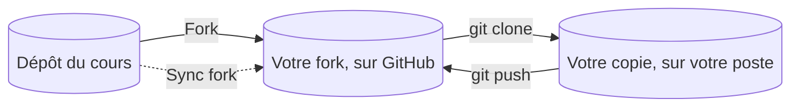
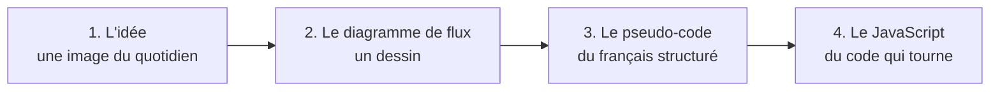

[Sommaire](Readme.md) · [Chapitre suivant →](02-Qu-est-ce-qu-un-algorithme.md)

# Mise en route

## 🎯 Objectifs

À la fin de ce chapitre, vous saurez :

1. Récupérer le cours en forkant son dépôt, et le mettre à jour.
2. Comment ce cours se travaille seul, et à quoi servent les étoiles des exercices.
3. Demander de l'aide efficacement, sur le Discord et à Nami.
4. Ouvrir le playground, y écrire du code et l'exécuter.
5. Afficher un résultat avec `console.log()` et lire une valeur avec `lire()`.
6. Lancer les tests d'un exercice et comprendre ce qu'ils vous disent.
7. Lire un message d'erreur et corriger votre code.
8. Télécharger votre journal le soir du deuxième jour, et le déposer sur Moodle.

> ⏱ **Durée indicative** : 40 min · **Exercices** : 1.1 à 1.3, tous obligatoires.

---

## 1. Récupérer le cours : forker le dépôt

Le cours vit dans un dépôt GitHub. Plutôt que de le télécharger, **forkez-le** : vous obtenez votre propre copie du dépôt, sous votre compte GitHub, que vous clonez ensuite sur votre poste.



1. Sur la page GitHub du cours, cliquez sur **Fork**, en haut à droite, puis sur **Create fork** : le dépôt est copié sous votre compte.
2. Clonez **votre fork**, et non le dépôt d'origine :

   ```bash
   git clone https://github.com/<votre-compte>/Intro-programmation-algorithmique.git
   cd Intro-programmation-algorithmique
   ```

   Avec la GitHub CLI, une seule commande fait les deux : `gh repo fork DiginamicAcademy/Intro-programmation-algorithmique --clone`.

3. **Pour récupérer les mises à jour** du cours, s'il est corrigé pendant votre formation : bouton **Sync fork** sur la page de votre fork, puis `git pull` dans votre dossier.

Votre fork est à vous : versionnez-y vos notes, ou le jeu du mini-projet, que vous pourrez même publier en ligne (chapitre 10). Rangez-les dans un dossier à vous, par exemple `mon-travail/`, et commitez au fil des deux jours. Le code des exercices, lui, est sauvegardé par le playground dans votre navigateur, pas dans le dépôt (voir la section 4).

> Le playground est aussi disponible en ligne, sans rien cloner : **[▶ Ouvrir le playground](https://diginamicacademy.github.io/Intro-programmation-algorithmique/playground/)**. Le fork reste la façon recommandée de récupérer le cours : vous en avez une copie complète, utilisable hors connexion, que vous pouvez mettre à jour et où vous pouvez versionner votre travail.

> **Besoin d'un rappel sur Git ?** Le fork est présenté au [chapitre 06 du cours *Git et GitHub 101*](https://github.com/DiginamicAcademy/Git-GitHub-101/blob/main/06-Collaborer-avec-les-pull-requests.md), le clone et la synchronisation au [chapitre 05](https://github.com/DiginamicAcademy/Git-GitHub-101/blob/main/05-Travailler-avec-GitHub.md). Si Git vous résiste, ne restez pas bloqué : le bouton **Code** → **Download ZIP** de la page du cours donne une copie sans historique, suffisante pour commencer. Vous forkerez plus tard.

---

## 2. Travailler seul, mais pas sans méthode

Ce cours se suit **à votre rythme**, sans formateur et sans exposé. Tout est écrit : les explications, les exemples, les exercices, les indices et les corrections. Pour vous débloquer, le Discord et Nami : c'est l'objet de la section suivante.

### Chaque chapitre suit le même chemin

Une notion se découvre toujours en quatre temps, du plus concret au plus formel :



Viennent ensuite les **pièges** classiques, les **exercices**, et une liste **« Je sais… »** pour faire le point avant de passer au chapitre suivant.

### Trois niveaux d'exercices

| Niveau | Rôle | À faire ? |
|---|---|---|
| ⭐ | s'échauffer : appliquer la notion telle qu'elle vient d'être montrée | oui |
| ⭐⭐ | l'exercice type : combiner, réfléchir un peu | oui |
| ⭐⭐⭐ | approfondissement : pour aller plus loin | si vous avez le temps |

Les ⭐ et ⭐⭐ forment le **socle** : c'est ce qui est attendu de tout le monde à la fin des deux jours. Les ⭐⭐⭐ sont là pour ceux qui avancent vite ; ne restez pas bloqué dessus au détriment du chapitre suivant.

### La méthode, pour chaque exercice

1. **Lire l'énoncé en entier**, exemples compris.
2. **Réfléchir avant de coder** : sur papier, un diagramme ou quelques lignes de pseudo-code. Deux minutes ici en font gagner dix au clavier.
3. **Coder**, puis **exécuter** pour voir ce que fait votre programme.
4. **Tester** : les tests disent si c'est juste, et sinon, ce qui ne va pas.
5. Bloqué ? Les **indices** 💡 du playground, l'un après l'autre.
6. Toujours bloqué ? Un **coup de pouce** sur le Discord ou auprès de Nami.
7. En dernier recours, la **correction**, dans le support. Lisez-la, fermez-la, puis réécrivez le code **sans la regarder**.

> **La règle des 10 minutes.** Si vous tournez en rond depuis dix minutes malgré les indices, demandez, sur le Discord ou à Nami. Chercher fait partie de l'apprentissage ; s'enliser, non.

---

## 3. Demander de l'aide : le Discord et Nami

Personne ne déroule ce cours au tableau, mais vous n'êtes pas seul :

- **le Discord** de la formation : posez vos questions aux autres apprenants, et répondez aux leurs. Expliquer à quelqu'un d'autre est l'une des meilleures façons d'apprendre. Aidez avec des indices plutôt qu'avec des solutions toutes faites : qui recopie une solution n'a rien appris ;
- **Nami**, l'IA du Discord, disponible à toute heure, pour expliquer une notion ou un message d'erreur, ou vous mettre sur la piste.

### Bien utiliser Nami

Une IA peut écrire le code d'un exercice à votre place. Ce serait vous priver de l'essentiel : c'est en cherchant qu'on apprend à programmer, et c'est cette compétence-là qu'on attendra de vous ensuite. Servez-vous de Nami comme d'un **tuteur**, pas comme d'un distributeur de solutions :

- **demandez un indice ou une explication, pas la solution** : « donne-moi un indice, sans écrire le code » ;
- **donnez le contexte** : le numéro et l'énoncé de l'exercice, votre code, le message d'erreur exact ou le test qui échoue, et ce que vous avez déjà essayé ;
- **expliquez votre raisonnement**, et demandez où il cloche : c'est souvent en l'écrivant qu'on trouve ;
- **vérifiez les réponses** : une IA peut se tromper avec beaucoup d'aplomb. Le playground, lui, ne ment pas : testez ;
- **ne collez pas un code tout fait** : si une réponse en contient, lisez-le, comprenez-le, fermez-le, puis réécrivez-le vous-même.

Une question bien posée ressemble à ceci :

```text
Je suis le cours d'algorithmique, exercice 5.3 « La somme de 1 à n ».
Voici mon code :
  (votre code)
Le test « avec n = 10 » échoue : « Ligne 2 en trop : Somme : 3 ».
J'ai essayé de changer la condition de la boucle, sans succès.
Peux-tu m'expliquer ce qui ne va pas, sans me donner la solution ?
```

Avant de demander, l'[annexe B](B-Deboguer-seul.md) propose une méthode pour chercher seul : elle suffit souvent.

---

## 4. Le playground

Le **playground** est une page web, livrée avec le cours, où vous écrivez et exécutez votre code. Il ne demande aucune installation. Il s'ouvre dans Chrome, Edge ou Firefox, dans une version récente.

1. **Depuis votre copie du cours**, celle que vous venez de cloner : ouvrez `playground/index.html` par un double-clic. Il fonctionne même sans connexion.
2. Il est **aussi disponible en ligne**, à cette adresse : **[▶ Ouvrir le playground](https://diginamicacademy.github.io/Intro-programmation-algorithmique/playground/)**. Pratique si vous n'avez pas encore réussi à cloner le cours, ou depuis un autre poste.

Quelle que soit la façon choisie, **tenez-vous-y pendant les deux jours** : le playground garde votre travail dans le navigateur, et la version en ligne et la version locale ne partagent pas la même mémoire. Ajoutez la page à vos favoris : vous y reviendrez à chaque exercice.

### Le tour du propriétaire


| Zone | Ce qu'on y fait |
|---|---|
| **Liste des exercices**, en haut | choisir un exercice ; un ✅ marque ceux que vous avez réussis, et le compteur à côté fait le total |
| **▶ Exécuter** (Ctrl+Entrée) | lancer votre code ; ce qu'il affiche apparaît dans la **console** |
| **✓ Tester** | lancer les tests de l'exercice ; le résultat s'affiche dans l'onglet **Tests** |
| **↺** | revenir au code de départ de l'exercice |
| **📓 Journal** | votre auto-évaluation, et le journal à télécharger le soir du deuxième jour (voir ci-dessous) |
| **🌓** | le thème : automatique (celui de votre système), clair ou sombre |
| **?** | l'aide du playground |
| **Énoncé**, à gauche | la consigne, des exemples, et les indices 💡 |
| **Éditeur**, à gauche | votre code ; il est **sauvegardé automatiquement** dans le navigateur |
| **Entrées**, à droite | les valeurs que votre programme lit avec `lire()` |
| **Console**, **Tests**, **Page** | ce qu'affiche votre programme, le verdict des tests, et, à partir du chapitre 06, la page web que manipule votre code |

En haut de la liste, deux **bacs à sable** vous laissent essayer ce que vous voulez, hors exercice.

Quelques exercices n'ont **pas de test automatique** : on y rédige une réponse (du pseudo-code, un tableau de suivi) et, parfois, on dessine un diagramme de flux dans l'**éditeur de schémas** du playground. Choisissez une forme, cliquez dans la zone, double-cliquez pour écrire dedans, et reliez les formes avec l'outil flèche. Quand vous avez fini, **✓ J'ai terminé** enregistre votre réponse ; comparez-la ensuite avec la correction du support.

> La sauvegarde est faite **dans le navigateur**, pas dans les fichiers du cours : votre fork ne contient donc pas votre code d'exercice. Changer de navigateur ou de poste, ou effacer les données de navigation, vous fait repartir du code de départ. **Travaillez les deux jours sur le même poste, avec le même navigateur.**

### Le journal, à déposer le deuxième soir

Le playground tient un **journal** de votre travail : pour chaque exercice, ce que vous avez tenté (le code de chaque essai), le résultat des tests, les indices ouverts, vos réponses et vos schémas, le tout horodaté. S'y ajoute votre **auto-évaluation** : les listes « Je sais… » qui terminent chaque chapitre, à cocher dans le playground.

**Le soir du deuxième jour, avant de partir :**

1. cliquez sur **📓 Journal** ;
2. indiquez votre prénom et votre nom, et cochez ce que vous savez faire dans l'auto-évaluation ;
3. cliquez sur **⬇ Télécharger mon journal** : un fichier `journal-prenom-nom-….json` est enregistré dans vos téléchargements ;
4. **déposez ce fichier sur Moodle**, dans le devoir prévu.

Le journal reprend tout depuis le début : celui du deuxième soir contient aussi le premier jour. Il porte une **signature** pour chaque étape et pour le fichier entier : toute modification après coup est détectée. Ne l'ouvrez donc pas pour le retoucher. Rien ne vous empêche de le télécharger dès le premier soir, pour en garder une sauvegarde : seul celui du deuxième soir se dépose sur Moodle.

---

## 5. Écrire et lire

Un programme reçoit des **entrées**, les traite, et produit des **sorties**. Pour commencer, deux instructions suffisent.

### Afficher : `console.log()`

`console.log()` affiche dans la console ce qu'on lui donne entre parenthèses :

```javascript
console.log("Bonjour !");     // un texte, entre guillemets
console.log(6 * 7);           // le résultat d'un calcul : 42
console.log("Total :", 6 * 7); // plusieurs valeurs, séparées par une espace : Total : 42
```

Un texte s'écrit entre guillemets, `"comme ceci"`. Sans guillemets, JavaScript croit lire un nom de variable ou un nombre.

### Lire : `lire()`

`lire("prenom")` va chercher la valeur nommée `prenom` dans le panneau **Entrées**, à droite de l'éditeur :

```javascript
const prenom = lire("prenom");          // avec, dans les Entrées : prenom = Ada
console.log("Bonjour " + prenom + " !"); // Bonjour Ada !
```

Le panneau **Entrées** contient une ligne par valeur, sous la forme `nom = valeur` :

```text
prenom = Ada
age = 36
taille = 1.68
notes = 12, 15, 9
```

- les nombres à virgule s'écrivent avec un **point** : `1.68` ;
- plusieurs valeurs séparées par des virgules se lisent **l'une après l'autre** : le premier `lire("notes")` donne 12, le deuxième 15, le troisième 9. On s'en servira avec les boucles.

Changer une valeur des Entrées et exécuter de nouveau permet d'essayer son programme dans plusieurs situations, sans toucher au code. Lors des tests, ce sont les tests qui fournissent les valeurs.

> `lire()` n'existe **que dans le playground**. C'est l'équivalent du `LIRE` du pseudo-code, que l'on verra au chapitre suivant. Dans une vraie page web, on lit plutôt ce que l'utilisateur a tapé dans un champ de formulaire : ce sera le chapitre 06.

---

## 6. Tester

**▶ Exécuter** montre ce que fait votre programme avec les valeurs du panneau Entrées. **✓ Tester** vérifie s'il fait ce qui est demandé : il l'exécute plusieurs fois, avec des entrées différentes, et compare chaque fois ce qu'il affiche à ce qui est attendu.

Le verdict apparaît dans l'onglet **Tests** :

- ✅ le test est réussi ;
- ❌ le test a échoué, avec une explication : la ligne qui diffère, ce qui était attendu et ce que votre programme a affiché.

La comparaison est **exacte**, caractère par caractère : une majuscule, une espace ou un point en trop suffisent à faire échouer un test. Quand l'écart ne tient qu'à cela, le message le signale par un « Presque ».

Quand tous les tests passent, l'exercice est marqué ✅ dans la liste et le bouton **Exercice suivant →** apparaît.

---

## 7. Quand ça ne marche pas

Votre code contient une erreur ? La console l'affiche en rouge, en trois parties :

1. **la ligne** où l'erreur a été détectée : cliquez dessus, l'éditeur s'y place et la surligne ;
2. **le message** de JavaScript, en anglais, tel que vous le retrouverez dans tous les outils du métier ;
3. **une explication** 💡, en français, qui propose les causes les plus probables.

Trois choses à savoir :

- **une erreur à la fois** : JavaScript s'arrête à la première. Corrigez-la, exécutez de nouveau, et passez à la suivante ;
- **la ligne indiquée est l'endroit où l'erreur a été remarquée**, pas toujours celui où elle a été commise : un guillemet oublié ligne 3 peut n'être détecté que ligne 4. Regardez aussi la ligne d'avant ;
- un programme qui ne s'arrête jamais, par exemple une **boucle infinie**, est interrompu au bout de 3 secondes, sans rien bloquer.

Le playground exécute votre code en **mode strict** : toute variable doit être déclarée avant d'être utilisée. C'est une protection : une faute de frappe dans un nom de variable déclenche une erreur au lieu de passer inaperçue.

L'[annexe B](B-Deboguer-seul.md) rassemble la méthode pour se débloquer seul et les erreurs les plus fréquentes.

---

## 8. Exercices

Dans le playground, choisissez l'exercice dans la liste : son numéro est celui du support.

### Exercice 1.1 ⭐ — Premier programme

Le programme de départ affiche `Bonjour !`. Exécutez-le, puis modifiez-le pour qu'il affiche **deux lignes** :

```text
Bonjour !
Je découvre le playground.
```

Lancez les tests. Essayez aussi d'en faire échouer un exprès, en oubliant le point final, pour voir comment le playground le signale.

<details>
<summary>Voir la correction</summary>

<!-- corrigé 1.1 -->
```javascript
console.log("Bonjour !");
console.log("Je découvre le playground.");
```

Un `console.log()` affiche une ligne : deux lignes demandent deux `console.log()`, exécutés dans l'ordre où ils sont écrits.

</details>

### Exercice 1.2 ⭐ — Lire une entrée

Le programme de départ lit un prénom avec `lire("prenom")` et affiche `Bonjour Ada !`. Exécutez-le, changez le prénom dans le panneau **Entrées**, exécutez de nouveau.

Modifiez-le ensuite pour qu'il affiche une phrase de bienvenue :

| Entrées | Affichage attendu |
|---|---|
| `prenom = Ada` | `Bienvenue, Ada !` |
| `prenom = Grace` | `Bienvenue, Grace !` |

<details>
<summary>Voir la correction</summary>

<!-- corrigé 1.2 -->
```javascript
const prenom = lire("prenom");
console.log("Bienvenue, " + prenom + " !");
```

Le signe `+` colle des morceaux de texte bout à bout : c'est la **concaténation**. Les espaces font partie des morceaux : `"Bienvenue, "` se termine par une espace, `" !"` commence par une espace.

</details>

### Exercice 1.3 ⭐ — Réparer un programme

Le programme de départ contient **deux erreurs**. Exécutez-le, lisez le message de la console, corrigez, exécutez de nouveau, jusqu'à obtenir :

| Entrées | Affichage attendu |
|---|---|
| `ville = Lyon` | `Vous habitez à Lyon.`<br>`Bon séjour !` |

<details>
<summary>Voir la correction</summary>

<!-- corrigé 1.3 -->
```javascript
const ville = lire("ville");
console.log("Vous habitez à " + ville + ".");
console.log("Bon séjour !");
```

Les deux erreurs, dans l'ordre où le playground les signale :

1. **ligne 3**, `SyntaxError: Invalid or unexpected token` : le texte `"Bon séjour !` n'est jamais refermé. Une erreur de **syntaxe** empêche tout le programme de démarrer : c'est pourquoi elle est signalée en premier, bien qu'elle soit la dernière du code ;
2. **ligne 2**, `ReferenceError: consol is not defined` : `consol` n'existe pas, il manque le `e` de `console`. Celle-là n'apparaît qu'une fois le programme lancé, au moment d'exécuter la ligne.

</details>

---

## ✅ Je sais…

- [ ] forker le dépôt du cours, cloner mon fork, et le mettre à jour avec *Sync fork* ;
- [ ] demander de l'aide sur le Discord ou à Nami, en donnant le contexte, et sans réclamer la solution ;
- [ ] ouvrir le playground et choisir un exercice ;
- [ ] afficher un texte ou un calcul avec `console.log()` ;
- [ ] lire une valeur du panneau Entrées avec `lire()`, et la changer pour essayer mon programme ;
- [ ] lancer les tests et lire un ❌ ;
- [ ] trouver la ligne d'une erreur et lire son explication ;
- [ ] me servir des indices avant d'ouvrir une correction ;
- [ ] télécharger mon journal le soir du deuxième jour et le déposer sur Moodle.

---

[Sommaire](Readme.md) · [Chapitre suivant →](02-Qu-est-ce-qu-un-algorithme.md)
