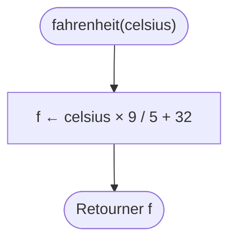
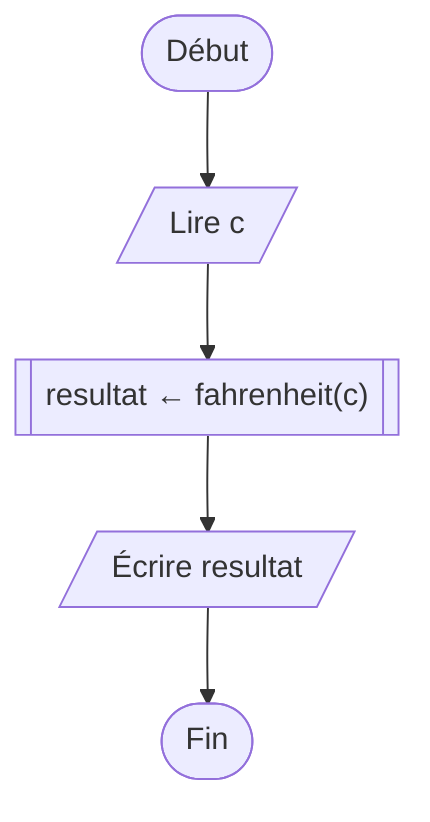
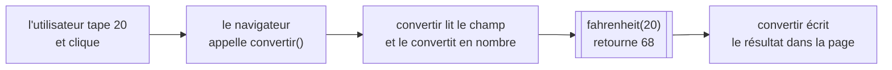

[← Chapitre précédent](05-Les-boucles.md) · [Sommaire](Readme.md) · [Chapitre suivant →](07-Algorithmes-sur-les-tableaux.md)

# Les fonctions

## 🎯 Objectifs

À la fin de ce chapitre, vous saurez :

1. Découper un problème en sous-problèmes, et confier chacun à une fonction.
2. Écrire une fonction avec des paramètres et une valeur de retour.
3. Distinguer **afficher** et **retourner**.
4. Appeler une fonction, et réutiliser vos fonctions dans d'autres.
5. Dire où une variable existe : sa portée.
6. Brancher une fonction sur une page web : lire un champ, réagir à un clic, afficher un résultat.

> ⏱ **Durée indicative** : 1 h 30 · **Exercices** : 6.1 à 6.5 obligatoires, 6.6 et 6.7 en approfondissement.

---

## 1. L'idée : la recette de la pâte brisée

Ouvrez un livre de cuisine : la tarte aux pommes, la quiche et la tarte au citron disent toutes « préparer une pâte brisée (voir page 12) ». La recette de la pâte brisée est écrite **une fois**, à part, avec un nom, et chaque recette qui en a besoin y **renvoie**. Si l'on améliore la pâte, toutes les tartes en profitent.

C'est exactement ce qu'est une **fonction** : un morceau d'algorithme **nommé**, écrit une fois et utilisé autant de fois qu'on veut. Comme un distributeur de boissons, elle reçoit des données — les **paramètres** —, fait son travail, et rend un résultat — la **valeur de retour**. Pas besoin de savoir comment elle fonctionne à l'intérieur pour s'en servir : il suffit de connaître son nom, ce qu'elle attend et ce qu'elle rend.

Les fonctions servent à :

- **ne pas se répéter** : un calcul écrit une fois, corrigé une fois ;
- **découper** un gros problème en petits problèmes, chacun avec un nom qui dit ce qu'il fait ;
- **tester** chaque morceau séparément : c'est ce que feront les tests du playground à partir de maintenant ;
- **lire** le code comme une phrase : `if (estBissextile(annee))` se comprend sans effort.

Deux mots de vocabulaire. On **définit** une fonction une fois (on écrit sa recette), on l'**appelle** autant de fois qu'on veut (on s'en sert). Les **paramètres** sont les noms des données dans la définition ; les **arguments** sont les valeurs données à l'appel.

---

## 2. Le diagramme de flux

Fil rouge du chapitre : convertir une température de degrés Celsius en degrés Fahrenheit, par la formule `°F = °C × 9 / 5 + 32`.

La fonction a son propre diagramme, qui commence par son nom et ses paramètres et se termine par `Retourner` :



L'algorithme principal l'**appelle**. L'appel se dessine avec un nouveau symbole, le rectangle à **double bord** :



Lors de l'appel, l'exécution « saute » dans la fonction, avec la valeur de `c` dans le paramètre `celsius` ; à `Retourner`, elle revient à l'endroit de l'appel, avec le résultat.

---

## 3. Le pseudo-code

```text
FONCTION fahrenheit(celsius : NOMBRE) : NOMBRE
DÉBUT
  RETOURNER celsius × 9 / 5 + 32
FIN FONCTION

ALGORITHME Conversion
VARIABLES
  c : NOMBRE
DÉBUT
  LIRE c
  ÉCRIRE c, " °C = ", fahrenheit(c), " °F"
FIN
```

- La première ligne, la **signature**, donne le nom de la fonction, ses paramètres avec leur type, et le type de ce qu'elle retourne.
- `RETOURNER` termine la fonction **immédiatement** et renvoie la valeur à l'endroit de l'appel.
- À l'appel `fahrenheit(c)`, la valeur de `c` est recopiée dans le paramètre `celsius`.

### Afficher n'est pas retourner

C'est la distinction la plus importante du chapitre.

| | Afficher (`ÉCRIRE`, `console.log`) | Retourner (`RETOURNER`, `return`) |
|---|---|---|
| Pour qui ? | pour l'**humain** qui regarde l'écran | pour le **programme**, qui récupère la valeur |
| La valeur ensuite… | est perdue pour le programme | peut être rangée, combinée, testée, réaffichée |
| Image | la calculatrice affiche 212 | la calculatrice vous tend un papier où est écrit 212 |

Une fonction qui **calcule** doit **retourner** son résultat, et laisser l'affichage à celui qui l'appelle. Une fonction qui affiche au lieu de retourner ne peut servir qu'à afficher : impossible d'écrire `fahrenheit(20) + 1`, ou `SI fahrenheit(t) > 100`. Et les tests du playground, qui comparent ce que retourne votre fonction, échoueront.

---

## 4. En JavaScript

```javascript
function fahrenheit(celsius) {
  return celsius * 9 / 5 + 32;
}

console.log(fahrenheit(100));   // 212
const f = fahrenheit(20);       // f vaut 68
console.log(f + 1);             // 69
console.log(fahrenheit(-40));   // -40
```

| Pseudo-code | JavaScript |
|---|---|
| `FONCTION nom(p1, p2) : TYPE` | `function nom(p1, p2) {` |
| `RETOURNER valeur` | `return valeur;` |
| `FIN FONCTION` | `}` |
| appel : `nom(a, b)` | `nom(a, b)` |

### Retourner une condition

Une fonction peut retourner un booléen. Inutile d'écrire un `if` pour cela, la comparaison **est** déjà un booléen :

```javascript
// Juste, mais bavard :
function estMajeur(age) {
  if (age >= 18) {
    return true;
  } else {
    return false;
  }
}

// Pareil, en une ligne :
function estMajeur(age) {
  return age >= 18;
}
```

### Des fonctions qui en appellent d'autres

Une fonction peut se servir d'une autre, comme la quiche se sert de la pâte brisée :

```javascript
function fahrenheit(celsius) {
  return celsius * 9 / 5 + 32;
}

function decrireTemperature(celsius) {
  return celsius + " °C, soit " + fahrenheit(celsius) + " °F";
}

console.log(decrireTemperature(20));   // 20 °C, soit 68 °F
```

`return` arrête la fonction : ce qui suit n'est jamais exécuté. On s'en sert pour sortir tôt, quand la réponse est connue. Et une fonction qui se termine sans `return` retourne `undefined`.

> Vous croiserez très souvent une autre écriture, la **fonction fléchée** : `const fahrenheit = (celsius) => celsius * 9 / 5 + 32;`. Pour ce cours, c'est la même chose : une fonction, rangée dans une constante. Les deux écritures sont acceptées par les tests.

### La portée des variables

Une variable déclarée **dans** une fonction, paramètres compris, n'existe **que dans cette fonction** : elle est **locale**. Ce qui se passe dans la cuisine reste dans la cuisine.

```javascript
function doubler(x) {
  const resultat = x * 2;
  return resultat;
}

console.log(doubler(4));   // 8
console.log(resultat);     // ReferenceError: resultat is not defined
```

C'est une protection : deux fonctions peuvent chacune avoir leur variable `resultat` sans se gêner. Il en va de même pour toute variable déclarée avec `let` ou `const` entre accolades, dans un `if` ou une boucle. Pour faire sortir une valeur d'une fonction, un seul chemin : `return`. Pour en faire entrer une : les paramètres.

---

## 5. Brancher une fonction sur une page web

Vous savez écrire une page en HTML. JavaScript peut la rendre vivante en quatre gestes :

| Geste | JavaScript |
|---|---|
| trouver un élément de la page, par son `id` | `document.querySelector("#celsius")` |
| lire ce que l'utilisateur a tapé dans un champ | `champ.value` — **toujours du texte** |
| réagir à un clic sur un bouton | `bouton.addEventListener("click", nomDeLaFonction)` |
| afficher un texte dans un élément | `element.textContent = "…"` |

Le convertisseur de température, en page web :



Le HTML :

```html
<label for="celsius">Température en °C</label>
<input id="celsius" type="number">
<button id="convertir">Convertir</button>
<p id="resultat"></p>
```

Le JavaScript :

```javascript
// Le calcul : une fonction qui ne connaît rien de la page.
function fahrenheit(celsius) {
  return celsius * 9 / 5 + 32;
}

// Le lien avec la page : lire, calculer, afficher.
function convertir() {
  const saisie = document.querySelector("#celsius").value;   // du texte : "20"
  const celsius = Number(saisie);                             // un nombre : 20
  document.querySelector("#resultat").textContent = celsius + " °C = " + fahrenheit(celsius) + " °F";
}

// Quand on clique sur le bouton, le navigateur appellera convertir.
document.querySelector("#convertir").addEventListener("click", convertir);
```

Trois points à retenir :

- **`value` est toujours du texte**, même dans un `<input type="number">`. Avant de calculer, on convertit avec `Number()`. Sans cela, `"10" + 2` donne `"102"`.
- **`addEventListener("click", convertir)` : sans parenthèses après `convertir`.** On donne la fonction au navigateur, qui l'appellera au moment du clic. Avec des parenthèses, `convertir()` serait appelée tout de suite, une seule fois, au chargement.
- **Le calcul est séparé de l'affichage.** `fahrenheit` ne sait rien de la page : elle reçoit un nombre et en retourne un, on peut la tester et la réutiliser partout. `convertir` fait le lien : elle lit, appelle, affiche. C'est une habitude à prendre dès maintenant.

Essayez-le dans le **bac à sable page** du playground : le HTML dans l'onglet HTML, le JavaScript dans l'onglet JavaScript, puis Exécuter ; la page s'affiche dans l'onglet **Page**.

> Dans le playground, votre JavaScript s'exécute une fois la page chargée. Dans un vrai site, placez la balise `<script src="script.js" defer></script>` dans le `<head>` : l'attribut `defer` attend que le HTML soit lu avant d'exécuter le script. Sans lui, `querySelector` chercherait des éléments qui n'existent pas encore.

---

## 6. Les pièges

- **Le `return` oublié.** La fonction calcule, mais ne rend rien : elle retourne `undefined`. Les tests le signalent : « La fonction ne retourne rien ».
- **`console.log` au lieu de `return`.** Le résultat s'affiche quand on exécute, mais les tests échouent : afficher n'est pas retourner.
- **Le code après `return`.** Il n'est jamais exécuté.
- **`lire()` dans une fonction.** Une fonction reçoit ses données par ses **paramètres**, pas en allant les chercher elle-même. Les tests appellent `estPair(4)` : c'est le 4 qu'il faut utiliser.
- **L'ordre des arguments.** `diviser(10, 2)` et `diviser(2, 10)` ne donnent pas le même résultat : les arguments sont recopiés dans les paramètres **dans l'ordre**.
- **Les parenthèses dans `addEventListener`.** `addEventListener("click", calculer())` appelle `calculer` immédiatement : il faut `addEventListener("click", calculer)`.
- **Le mauvais sélecteur.** `querySelector("#resultat")` retourne `null` si aucun élément n'a cet `id` ; la ligne suivante échoue alors avec `Cannot set properties of null`. Vérifiez l'orthographe, et le `#`.

---

## 7. Exercices

À partir de ce chapitre, la plupart des exercices demandent d'écrire une **fonction**. Les tests l'**appellent** avec différents arguments et comparent ce qu'elle **retourne** à ce qui est attendu. Plus besoin de `lire()` : les données arrivent par les paramètres. Pour essayer votre fonction vous-même, ajoutez des appels sous sa définition, comme `console.log(estPair(4));`, et cliquez sur Exécuter.

### Exercice 6.1 ⭐ — Pair ?

Écrivez la fonction `estPair(n)`, qui retourne `true` si `n` est pair, `false` sinon.

| Appel | Résultat attendu |
|---|---|
| `estPair(4)` | `true` |
| `estPair(7)` | `false` |

<details>
<summary>Voir la correction</summary>

<!-- corrigé 6.1 -->
```javascript
function estPair(n) {
  return n % 2 === 0;
}
```

La comparaison `n % 2 === 0` vaut déjà `true` ou `false` : on la retourne telle quelle. C'est l'exercice 4.2, devenu une fonction réutilisable : `if (estPair(x))` se lit tout seul.

</details>

### Exercice 6.2 ⭐ — Le maximum

Écrivez la fonction `maximum(a, b)`, qui retourne le plus grand des deux nombres, sans utiliser `Math.max`.

| Appel | Résultat attendu |
|---|---|
| `maximum(3, 9)` | `9` |
| `maximum(-1, -7)` | `-1` |

<details>
<summary>Voir la correction</summary>

<!-- corrigé 6.2 -->
```javascript
function maximum(a, b) {
  if (a > b) {
    return a;
  }
  return b;
}
```

Si `a > b`, le premier `return` termine la fonction : la ligne suivante n'est jamais atteinte. Sinon, on arrive au second `return`. Pas besoin de `else` : c'est l'usage du `return` pour sortir tôt. Si les deux sont égaux, on retourne `b`, qui vaut autant que `a`.

</details>

### Exercice 6.3 ⭐⭐ — La mention, en fonction

Reprenez l'exercice 4.4 sous la forme d'une fonction `mention(note)`, qui **retourne** la mention au lieu de l'afficher : `"Insuffisant"`, `"Passable"`, `"Assez bien"`, `"Bien"`, `"Très bien"`, ou `"Note invalide"`.

| Appel | Résultat attendu |
|---|---|
| `mention(13.5)` | `"Assez bien"` |
| `mention(21)` | `"Note invalide"` |

<details>
<summary>Voir la correction</summary>

<!-- corrigé 6.3 -->
```javascript
function mention(note) {
  if (note < 0 || note > 20) {
    return "Note invalide";
  }
  if (note < 10) {
    return "Insuffisant";
  }
  if (note < 12) {
    return "Passable";
  }
  if (note < 14) {
    return "Assez bien";
  }
  if (note < 16) {
    return "Bien";
  }
  return "Très bien";
}
```

Chaque `return` termine la fonction : une suite de `if` suffit, sans `else`. Comparez avec l'exercice 4.4 : la logique est la même, mais le résultat est maintenant **réutilisable**, pour l'afficher (`console.log(mention(15))`), le mettre dans une page, ou le comparer.

</details>

### Exercice 6.4 ⭐⭐ — Les jours de l'année

Écrivez deux fonctions :

- `estBissextile(annee)`, qui retourne `true` si l'année est bissextile (la règle de l'exercice 4.5) ;
- `joursDansAnnee(annee)`, qui retourne 366 pour une année bissextile, 365 sinon, **en appelant** `estBissextile`.

| Appel | Résultat attendu |
|---|---|
| `estBissextile(2024)` | `true` |
| `joursDansAnnee(1900)` | `365` |

<details>
<summary>Voir la correction</summary>

<!-- corrigé 6.4 -->
```javascript
function estBissextile(annee) {
  return (annee % 4 === 0 && annee % 100 !== 0) || annee % 400 === 0;
}

function joursDansAnnee(annee) {
  if (estBissextile(annee)) {
    return 366;
  }
  return 365;
}
```

`joursDansAnnee` ne recopie pas la règle des années bissextiles : elle la **délègue**. Si la règle changeait, il n'y aurait qu'une fonction à corriger. Remarquez comme `if (estBissextile(annee))` se lit comme une phrase.

</details>

### Exercice 6.5 ⭐⭐ — La calculatrice de prix TTC

Exercice en **mode page**. La page contient un champ `#prixHT`, un bouton `#calculer` et un paragraphe `#resultat`. Quand on clique sur le bouton, le paragraphe doit afficher le prix TTC (TVA de 20 %), avec deux chiffres après la virgule :

| Saisie dans `#prixHT` | Affichage dans `#resultat` après le clic |
|---|---|
| `10` | `Prix TTC : 12.00 €` |
| `99.9` | `Prix TTC : 119.88 €` |

Organisez votre code comme le convertisseur : une fonction `prixTTC(prixHT)` pour le calcul, une fonction `calculer()` pour lire, calculer et afficher, et un `addEventListener` pour relier le bouton à `calculer`.

Pour les deux chiffres après la virgule, `nombre.toFixed(2)` retourne le nombre sous forme de texte, arrondi au centime : `(12).toFixed(2)` donne `"12.00"`.

<details>
<summary>Voir la correction</summary>

<!-- corrigé 6.5 -->
```javascript
function prixTTC(prixHT) {
  return prixHT * 1.2;
}

function calculer() {
  const prixHT = Number(document.querySelector("#prixHT").value);
  const texte = "Prix TTC : " + prixTTC(prixHT).toFixed(2) + " €";
  document.querySelector("#resultat").textContent = texte;
}

document.querySelector("#calculer").addEventListener("click", calculer);
```

Sans `Number()`, le calcul `"10" * 1.2` marcherait par chance (la multiplication convertit le texte toute seule), mais la moindre addition, comme `prixHT + prixHT * 0.2`, collerait du texte : `"10" + 2` donne `"102"`. Convertir dès la lecture évite toute surprise.

`toFixed(2)` règle aussi l'imprécision des nombres à virgule : `99.9 * 1.2` vaut en réalité `119.88000000000001`, et `toFixed(2)` l'affiche `119.88`.

</details>

### Exercice 6.6 ⭐⭐⭐ — Le plus grand diviseur commun

Le **PGCD** de deux entiers est le plus grand nombre qui les divise tous les deux : le PGCD de 48 et 18 est 6. Il y a plus de 2 300 ans, Euclide a décrit une méthode pour le calculer, que l'on utilise encore :

> Tant que `b` n'est pas nul, remplacer `(a, b)` par `(b, a MOD b)`. Quand `b` vaut 0, le PGCD est `a`.

Écrivez la fonction `pgcd(a, b)`, en commençant par le tableau de suivi pour 48 et 18.

| Appel | Résultat attendu |
|---|---|
| `pgcd(48, 18)` | `6` |
| `pgcd(17, 5)` | `1` |

<details>
<summary>Voir la correction</summary>

| Tour | a | b | a MOD b |
|---|---|---|---|
| départ | 48 | 18 | 12 |
| 1 | 18 | 12 | 6 |
| 2 | 12 | 6 | 0 |
| 3 | 6 | 0 | on s'arrête : le PGCD est 6 |

```text
FONCTION pgcd(a, b : NOMBRE) : NOMBRE
VARIABLES
  reste : NOMBRE
DÉBUT
  TANT QUE b ≠ 0 FAIRE
    reste ← a MOD b
    a ← b
    b ← reste
  FIN TANT QUE
  RETOURNER a
FIN FONCTION
```

<!-- corrigé 6.6 -->
```javascript
function pgcd(a, b) {
  while (b !== 0) {
    const reste = a % b;
    a = b;
    b = reste;
  }
  return a;
}
```

La variable `reste` est indispensable : si l'on écrivait `a = b` puis `b = a % b`, le calcul utiliserait le **nouveau** `a`. C'est le problème de l'échange de deux valeurs, vu au chapitre 03. Les paramètres `a` et `b` sont des variables locales comme les autres : on peut les modifier dans la fonction.

</details>

### Exercice 6.7 ⭐⭐⭐ — Le convertisseur de durée

Exercice en **mode page**. Reprenez l'exercice 3.4 pour en faire une page : un champ `#secondes`, un bouton `#convertir`, un paragraphe `#resultat`.

- Écrivez une fonction `formaterDuree(secondes)` qui **retourne** le texte `"1 h 2 min 5 s"`.
- Au clic, affichez ce texte dans `#resultat`, ou le message `Saisissez un nombre de secondes positif.` si le champ est vide ou négatif.

| Saisie dans `#secondes` | Affichage dans `#resultat` après le clic |
|---|---|
| `3725` | `1 h 2 min 5 s` |
| (vide) | `Saisissez un nombre de secondes positif.` |
| `-5` | `Saisissez un nombre de secondes positif.` |

<details>
<summary>Voir la correction</summary>

<!-- corrigé 6.7 -->
```javascript
function formaterDuree(secondes) {
  const heures = Math.floor(secondes / 3600);
  const minutes = Math.floor((secondes % 3600) / 60);
  return heures + " h " + minutes + " min " + (secondes % 60) + " s";
}

function convertir() {
  const saisie = document.querySelector("#secondes").value;
  const secondes = Number(saisie);
  const resultat = document.querySelector("#resultat");
  if (saisie === "" || secondes < 0) {
    resultat.textContent = "Saisissez un nombre de secondes positif.";
  } else {
    resultat.textContent = formaterDuree(secondes);
  }
}

document.querySelector("#convertir").addEventListener("click", convertir);
```

Le champ vide se teste sur le **texte saisi**, pas sur le nombre : `Number("")` vaut `0`, et un champ vide ferait afficher `0 h 0 min 0 s`. C'est pourquoi le texte est gardé dans sa propre variable, `saisie`.

`formaterDuree` ne sait rien de la page : c'est l'algorithme de l'exercice 3.4, rendu réutilisable. Toute la partie « page » est dans `convertir`.

</details>

---

## ✅ Je sais…

- [ ] expliquer à quoi sert une fonction, avec mes mots ;
- [ ] écrire une fonction avec des paramètres et un `return` ;
- [ ] distinguer afficher (`console.log`) et retourner (`return`), et savoir quand utiliser l'un ou l'autre ;
- [ ] appeler une fonction depuis une autre ;
- [ ] expliquer pourquoi une variable déclarée dans une fonction n'existe pas en dehors ;
- [ ] lire un champ (`value`, puis `Number()`), réagir à un clic (`addEventListener`) et afficher dans la page (`textContent`) ;
- [ ] séparer le calcul de l'affichage.

---

[← Chapitre précédent](05-Les-boucles.md) · [Sommaire](Readme.md) · [Chapitre suivant →](07-Algorithmes-sur-les-tableaux.md)
