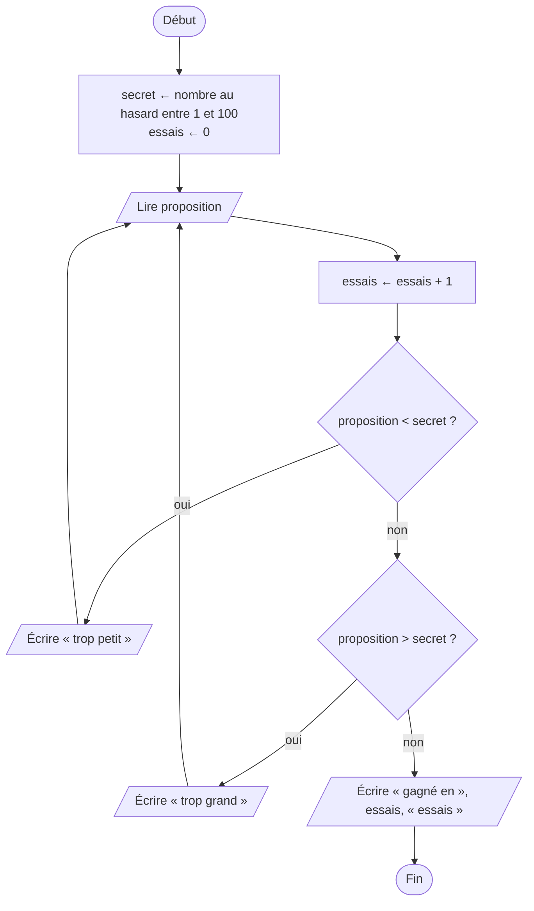
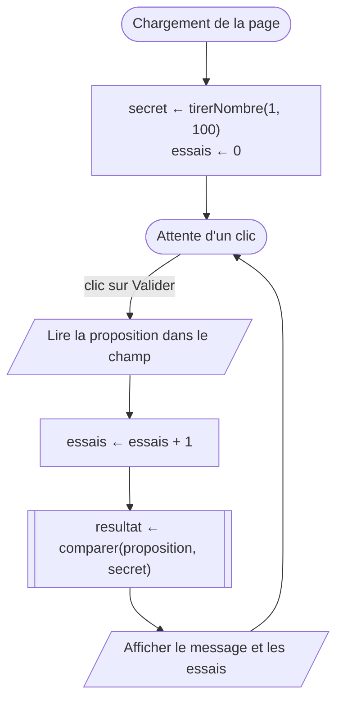

[← Chapitre précédent](09-Recursivite-et-complexite.md) · [Sommaire](Readme.md) · [Chapitre suivant →](A-Aide-memoire.md)

# Mini-projet : le nombre mystère

## 🎯 Objectifs

À la fin de ce mini-projet, vous saurez :

1. Mener un petit projet de bout en bout : analyse, algorithme, code, tests.
2. Combiner tout ce que vous avez appris : variables, conditions, boucles, fonctions, tableaux.
3. Séparer la logique d'un jeu de son affichage dans une page web.
4. Faire jouer l'ordinateur, grâce à la recherche dichotomique.

> ⏱ **Durée indicative** : 2 h 30 · **Étapes** : 10.1 à 10.4 obligatoires (versions 1 et 2), 10.5 et 10.6 en approfondissement (version 3).

---

## 1. Le jeu

L'ordinateur choisit un nombre entier **au hasard entre 1 et 100**. Le joueur propose des nombres ; à chaque proposition, le jeu répond « trop petit », « trop grand » ou « gagné », et compte les essais.

Le projet se construit en trois versions, chacune jouable :

| Version | Ce qu'elle ajoute | Ce qu'elle mobilise | Étapes |
|---|---|---|---|
| **v1** | le jeu, jouable dans une page | conditions, fonctions, page web | 10.1 à 10.3 |
| **v2** | l'historique des propositions, une nouvelle partie, le meilleur score | tableaux, état du jeu | 10.4 |
| **v3** | les rôles s'inversent : l'ordinateur devine **votre** nombre | dichotomie, complexité | 10.5 et 10.6 |

Chaque étape a son exercice dans le playground, avec ses tests. Comme dans un vrai projet, on avance **par petits morceaux testés**, plutôt que d'écrire tout d'un coup et de chercher ensuite pourquoi rien ne marche.

---

## 2. Étape 0 : analyser, avant de coder

Avant la moindre ligne de code, un quart d'heure de réflexion. Répondez dans le playground, exercice 10.0 : la zone de texte pour les réponses et le pseudo-code, l'éditeur de schémas pour le diagramme.

1. Quelles sont les **entrées** du jeu ? Ses **sorties** ?
2. Quelles informations le jeu doit-il **retenir** d'une proposition à l'autre ?
3. Dessinez le **diagramme de flux** d'une partie, comme si le jeu se jouait dans la console, avec `LIRE` et `ÉCRIRE`.
4. Écrivez son **pseudo-code**.

<details>
<summary>Voir une analyse possible</summary>

1. Entrée : la proposition du joueur, à chaque tour. Sorties : le message (trop petit, trop grand, gagné) et le nombre d'essais.
2. Le jeu retient le **nombre secret**, et le **nombre d'essais**. C'est l'**état** du jeu.
3. Le diagramme :



4. Le pseudo-code :

```text
ALGORITHME NombreMystere
VARIABLES
  secret, proposition, essais : NOMBRE
DÉBUT
  secret ← nombre au hasard entre 1 et 100
  essais ← 0
  RÉPÉTER
    LIRE proposition
    essais ← essais + 1
    SI proposition < secret ALORS
      ÉCRIRE "trop petit"
    SINON SI proposition > secret ALORS
      ÉCRIRE "trop grand"
    FIN SI
  JUSQU'À proposition = secret
  ÉCRIRE "gagné en ", essais, " essais"
FIN
```

C'est un `RÉPÉTER … JUSQU'À` : on propose au moins une fois, et l'on recommence jusqu'à trouver.

</details>

### Dans une page, la boucle disparaît

Dans une page web, il n'y a pas de boucle qui attend que le joueur tape un nombre. C'est le joueur qui mène : chaque **clic** sur le bouton déclenche **un tour** de jeu. Le corps de la boucle devient la fonction appelée au clic, et l'état du jeu (le secret, les essais) vit dans des variables déclarées **en dehors** de cette fonction, pour survivre d'un clic à l'autre.



Le cœur du jeu, lui, ne change pas : comparer une proposition au secret. On l'écrit donc d'abord, à part, dans une fonction qui ne sait rien de la page.

---

## 3. Version 1 : le jeu

### Étape 10.1 ⭐ — Comparer

Écrivez `comparer(proposition, secret)`, qui **retourne** `"trop petit"`, `"trop grand"` ou `"gagné"`.

| Appel | Résultat attendu |
|---|---|
| `comparer(20, 43)` | `"trop petit"` |
| `comparer(50, 43)` | `"trop grand"` |
| `comparer(43, 43)` | `"gagné"` |

<details>
<summary>Voir la correction</summary>

<!-- corrigé 10.1 -->
```javascript
function comparer(proposition, secret) {
  if (proposition < secret) {
    return "trop petit";
  }
  if (proposition > secret) {
    return "trop grand";
  }
  return "gagné";
}
```

Toute la règle du jeu tient dans cette fonction. Elle retourne un texte au lieu de l'afficher : la page décidera comment le montrer.

</details>

### Étape 10.2 ⭐ — Tirer un nombre au hasard

`Math.random()` retourne un nombre à virgule au hasard, supérieur ou égal à 0 et **strictement inférieur** à 1 : `0.42`, `0.0071`, `0.9998`… Pour en faire un entier entre 1 et 100 :

| Calcul | Avec 0.42 | Avec 0.9998 | Ce qu'on obtient |
|---|---|---|---|
| `Math.random()` | 0.42 | 0.9998 | de 0 à 0.999… |
| `Math.random() * 100` | 42 | 99.98 | de 0 à 99.999… |
| `Math.floor(Math.random() * 100)` | 42 | 99 | un entier de 0 à 99 |
| `Math.floor(Math.random() * 100) + 1` | 43 | 100 | un entier de 1 à 100 |

Écrivez `tirerNombre(min, max)`, qui retourne un entier au hasard entre `min` et `max`, **bornes comprises**. Entre `min` et `max`, il y a `max − min + 1` valeurs possibles.

<details>
<summary>Voir la correction</summary>

<!-- corrigé 10.2 -->
```javascript
function tirerNombre(min, max) {
  return Math.floor(Math.random() * (max - min + 1)) + min;
}
```

`Math.random() * (max - min + 1)` donne un nombre de 0 à `max - min + 1` exclu ; `Math.floor` en fait un entier de 0 à `max - min` ; `+ min` le décale entre `min` et `max`. Les tests vérifient sur des milliers de tirages que toutes les valeurs restent dans les bornes, et qu'elles sont toutes atteintes.

</details>

### Étape 10.3 ⭐⭐ — La page du jeu

Exercice en **mode page**. La page fournie contient un champ `#proposition`, un bouton `#valider`, et deux paragraphes, `#message` et `#essais`. Recopiez vos fonctions `comparer` et `tirerNombre` des deux étapes précédentes, puis faites fonctionner le jeu :

- au chargement, le secret est tiré avec `tirerNombre(1, 100)`, et les essais sont à 0 ;
- à chaque clic sur `#valider` :
  - les essais augmentent de 1, et `#essais` affiche `Essais : 3` ;
  - si la proposition n'est pas la bonne, `#message` affiche la proposition et la réponse : `50 : trop grand` ;
  - si c'est gagné, `#message` affiche `Gagné ! Le nombre était 43.`

Pour que les tests sachent quel est le secret, ils **fixent le hasard** : `Math.random()` y retourne toujours 0.42, et le secret vaut donc 43. C'est pourquoi le secret doit être tiré avec votre fonction `tirerNombre`, une seule fois au chargement.

<details>
<summary>Voir la correction</summary>

<!-- corrigé 10.3 -->
```javascript
function comparer(proposition, secret) {
  if (proposition < secret) {
    return "trop petit";
  }
  if (proposition > secret) {
    return "trop grand";
  }
  return "gagné";
}

function tirerNombre(min, max) {
  return Math.floor(Math.random() * (max - min + 1)) + min;
}

// L'état du jeu : il doit survivre d'un clic à l'autre.
let secret = tirerNombre(1, 100);
let essais = 0;

function valider() {
  const proposition = Number(document.querySelector("#proposition").value);
  essais++;
  const resultat = comparer(proposition, secret);
  if (resultat === "gagné") {
    document.querySelector("#message").textContent = "Gagné ! Le nombre était " + secret + ".";
  } else {
    document.querySelector("#message").textContent = proposition + " : " + resultat;
  }
  document.querySelector("#essais").textContent = "Essais : " + essais;
}

document.querySelector("#valider").addEventListener("click", valider);
```

`secret` et `essais` sont déclarées **en dehors** de `valider` : déclarées dedans, elles seraient recréées à chaque clic, et le secret changerait à chaque proposition. `valider` ne contient aucune règle du jeu : elle lit, délègue à `comparer`, et affiche.

</details>

---

## 4. Version 2 : historique, nouvelle partie, meilleur score

### Étape 10.4 ⭐⭐ — Un jeu plus complet

Exercice en **mode page**. La page de la version 2 ajoute un `<span id="historique">`, un bouton `#rejouer` et un paragraphe `#record`. Partez de votre code de la version 1, et ajoutez :

- **l'historique** : `#historique` affiche les propositions de la partie, séparées par une virgule et une espace : `50, 20, 43`. Rangez-les dans un **tableau**, et affichez-le avec `historique.join(", ")`, qui assemble les cases d'un tableau en un texte ;
- **la nouvelle partie** : un clic sur `#rejouer` tire un nouveau secret, remet les essais à 0, vide l'historique et efface le message ;
- **le meilleur score** : quand une partie est gagnée avec moins d'essais que le record, `#record` affiche `Meilleur score : 3`. Avant la première victoire, il n'y a pas de record.

Les tests fixent le hasard : le premier secret vaut 43, le suivant 8. Tirez donc le secret avec `tirerNombre(1, 100)`, une fois au chargement, puis une fois à chaque nouvelle partie.

Un conseil d'organisation : écrivez une fonction `nouvellePartie()` qui remet tout l'état à zéro, appelez-la au chargement **et** au clic sur `#rejouer`.

<details>
<summary>Voir la correction</summary>

<!-- corrigé 10.4 -->
```javascript
function comparer(proposition, secret) {
  if (proposition < secret) {
    return "trop petit";
  }
  if (proposition > secret) {
    return "trop grand";
  }
  return "gagné";
}

function tirerNombre(min, max) {
  return Math.floor(Math.random() * (max - min + 1)) + min;
}

// L'état du jeu.
let secret;
let essais;
let historique;
let record = null;   // null : aucune partie gagnée pour l'instant

function afficher(message) {
  document.querySelector("#message").textContent = message;
  document.querySelector("#essais").textContent = "Essais : " + essais;
  document.querySelector("#historique").textContent = historique.join(", ");
}

function nouvellePartie() {
  secret = tirerNombre(1, 100);
  essais = 0;
  historique = [];
  afficher("");
}

function valider() {
  const proposition = Number(document.querySelector("#proposition").value);
  essais++;
  historique.push(proposition);
  const resultat = comparer(proposition, secret);
  if (resultat === "gagné") {
    if (record === null || essais < record) {
      record = essais;
      document.querySelector("#record").textContent = "Meilleur score : " + record;
    }
    afficher("Gagné ! Le nombre était " + secret + ".");
  } else {
    afficher(proposition + " : " + resultat);
  }
}

document.querySelector("#valider").addEventListener("click", valider);
document.querySelector("#rejouer").addEventListener("click", nouvellePartie);
nouvellePartie();
```

Trois idées à retenir :

- **une fonction pour (ré)initialiser l'état** : le même code sert au chargement et à chaque nouvelle partie, sans rien oublier ;
- **une fonction pour afficher l'état** : `afficher` met à jour toute la page d'un coup, au lieu de disperser des `textContent` partout ;
- **`null` pour « pas encore de valeur »** : le record n'existe pas avant la première victoire. Initialiser le record à 0 serait faux, puisqu'aucune partie ne se gagne en moins de 0 essai ; on ne le battrait jamais.

Le record, c'est le patron du **meilleur jusqu'ici** du chapitre 07, appliqué aux parties successives.

</details>

---

## 5. Version 3 : l'ordinateur devine

Les rôles s'inversent : vous pensez à un nombre, l'ordinateur le devine. Avec la stratégie de la **dichotomie** du chapitre 08, il lui faut **7 essais au plus** entre 1 et 100, car 2⁷ = 128 dépasse 100.

### Étape 10.5 ⭐⭐⭐ — La stratégie de l'ordinateur

Écrivez `devinerParDichotomie(secret, min, max)`, qui simule une partie : l'ordinateur propose le milieu de l'intervalle, `Math.floor((min + max) / 2)`, utilise `comparer` pour savoir s'il est trop petit, trop grand ou s'il a gagné, et resserre l'intervalle en conséquence. La fonction retourne le **tableau des propositions** de l'ordinateur, la dernière étant le secret.

| Appel | Résultat attendu |
|---|---|
| `devinerParDichotomie(43, 1, 100)` | `[50, 25, 37, 43]` |
| `devinerParDichotomie(50, 1, 100)` | `[50]` |

Un des tests essaie tous les secrets de 1 à 100 et vérifie que l'ordinateur ne fait jamais plus de 7 propositions.

<details>
<summary>Voir la correction</summary>

<!-- corrigé 10.5 -->
```javascript
function comparer(proposition, secret) {
  if (proposition < secret) {
    return "trop petit";
  }
  if (proposition > secret) {
    return "trop grand";
  }
  return "gagné";
}

function devinerParDichotomie(secret, min, max) {
  const propositions = [];
  let resultat = "";
  while (resultat !== "gagné") {
    const proposition = Math.floor((min + max) / 2);
    propositions.push(proposition);
    resultat = comparer(proposition, secret);
    if (resultat === "trop petit") {
      min = proposition + 1;
    } else if (resultat === "trop grand") {
      max = proposition - 1;
    }
  }
  return propositions;
}
```

C'est la recherche dichotomique de l'exercice 8.2, où le tableau trié est remplacé par l'intervalle des nombres de 1 à 100. Chaque proposition élimine la moitié des nombres restants : 100, puis 50, 25, 12, 6, 3, 1. C'est pourquoi 7 propositions suffisent toujours. Entre 1 et 1 000 000, il en faudrait 20 au plus : la complexité O(log n) du chapitre 09.

</details>

### Étape 10.6 ⭐⭐⭐ — La page où l'ordinateur devine

Exercice en **mode page**. La page fournie contient un paragraphe `#proposition`, trois boutons `#plusPetit`, `#plusGrand` et `#trouve`, et un paragraphe `#message`. Le joueur pense à un nombre entre 1 et 100 ; l'ordinateur propose, le joueur répond avec les boutons.

- Au chargement, l'ordinateur propose le milieu, 50 : `#proposition` affiche `Je propose : 50`.
- `#plusGrand` : le nombre est plus grand ; l'ordinateur resserre l'intervalle et propose le nouveau milieu. `#plusPetit` : idem, dans l'autre sens.
- `#trouve` : `#message` affiche `J'ai trouvé en 7 essais !`, en comptant toutes les propositions, la première comprise.
- Si les réponses du joueur se contredisent, l'intervalle devient vide (`min > max`) : `#message` affiche `Vous avez triché !`

Utilisez le même calcul du milieu, `Math.floor((min + max) / 2)` : les tests rejouent une partie où le joueur pense à 70, et attendent les propositions 50, 75, 62, 68, 71, 69, puis 70.

<details>
<summary>Voir la correction</summary>

<!-- corrigé 10.6 -->
```javascript
let min = 1;
let max = 100;
let proposition;
let essais = 0;

function proposer() {
  if (min > max) {
    document.querySelector("#message").textContent = "Vous avez triché !";
    return;
  }
  proposition = Math.floor((min + max) / 2);
  essais++;
  document.querySelector("#proposition").textContent = "Je propose : " + proposition;
}

function plusGrand() {
  min = proposition + 1;
  proposer();
}

function plusPetit() {
  max = proposition - 1;
  proposer();
}

function trouve() {
  document.querySelector("#message").textContent = "J'ai trouvé en " + essais + " essais !";
}

document.querySelector("#plusGrand").addEventListener("click", plusGrand);
document.querySelector("#plusPetit").addEventListener("click", plusPetit);
document.querySelector("#trouve").addEventListener("click", trouve);
proposer();
```

L'état du jeu, ce sont les bornes `min` et `max` de l'intervalle encore possible. Chaque bouton ne fait que déplacer une borne, puis demander une nouvelle proposition. L'intervalle vide est la preuve que le joueur s'est contredit : il n'existe aucun nombre qui respecte toutes ses réponses.

</details>

---

## 6. Grille d'auto-évaluation

Avant de considérer le projet terminé, relisez votre code avec cette grille :

- [ ] j'ai fait le diagramme et le pseudo-code **avant** de coder ;
- [ ] `comparer` et `tirerNombre` passent leurs tests ;
- [ ] la v1 est jouable, et ses tests passent ;
- [ ] la v2 gère l'historique, la nouvelle partie et le meilleur score ;
- [ ] la logique du jeu (`comparer`) est séparée de l'affichage ;
- [ ] l'état du jeu est déclaré en dehors des fonctions appelées au clic, et réinitialisé par une seule fonction ;
- [ ] mes variables et mes fonctions ont des noms qui disent ce qu'elles contiennent ou font ;
- [ ] mon code est indenté, et je n'ai pas recopié deux fois le même bloc.

## 7. Pour aller plus loin

Si vous avez fini, de quoi continuer à votre rythme, dans le bac à sable page ou dans un vrai fichier HTML :

- **valider la saisie** : refuser un champ vide, un nombre hors de 1 à 100, ou à virgule, avec un message clair ;
- **jouer au clavier** : valider avec la touche Entrée, en écoutant l'évènement `keydown` du champ et en testant `evenement.key === "Enter"` ;
- **finir proprement** : désactiver le bouton après la victoire (`bouton.disabled = true`) et le réactiver à la nouvelle partie ;
- **des niveaux** : de 1 à 10, de 1 à 100, de 1 à 1 000, avec un nombre d'essais limité, calculé grâce à la dichotomie ;
- **retenir le record** d'une visite à l'autre : `localStorage.setItem("record", record)` l'enregistre dans le navigateur, `localStorage.getItem("record")` le relit, sous forme de texte ;
- **publier votre jeu** : recopiez-le dans votre fork, dans un dossier `mon-travail/nombre-mystere/`, avec un `index.html` et un `script.js` reliés par `<script src="script.js" defer></script>`. Commitez, poussez, puis activez **GitHub Pages** dans les réglages de votre fork (*Settings* → *Pages*, source *Deploy from a branch*, branche `main`). Quelques minutes plus tard, votre jeu est en ligne à l'adresse `https://<votre-compte>.github.io/Intro-programmation-algorithmique/mon-travail/nombre-mystere/` ;
- **un autre jeu** : le pendu, avec un tableau de mots, un mot tiré au hasard, et l'affichage des lettres trouvées.

---

> 🌙 **Fin du jour 2.** Avant de partir : **📓 Journal** dans le playground, cochez votre auto-évaluation, téléchargez votre journal et déposez-le sur Moodle. C'est le seul dépôt de la formation : il contient tout votre travail des deux jours.

---

## 8. Le bilan

En deux jours, vous êtes passé de la recette de cuisine à un jeu jouable dans une page web. Le plus important n'est pas la syntaxe de JavaScript, qui se retrouve en un instant dans la documentation, mais la **démarche** :

1. **comprendre le problème** : ses entrées, ses sorties, ce qu'il faut retenir ;
2. **concevoir l'algorithme** : un diagramme, un pseudo-code, et des cas à tester, frontières comprises ;
3. **le traduire** dans un langage, par petits morceaux testés ;
4. **se demander ce qu'il coûte**, quand les données grandiront.

Cette démarche vaut pour tous les langages que vous apprendrez. Pour la suite, le cours [*Concepts généraux en programmation*](https://github.com/DiginamicAcademy/Principes-generaux-en-programmation) prolonge celui-ci avec les objets, les classes et les modules, et l'[aide-mémoire](A-Aide-memoire.md) rassemble tout ce que vous avez vu ici.

---

[← Chapitre précédent](09-Recursivite-et-complexite.md) · [Sommaire](Readme.md) · [Chapitre suivant →](A-Aide-memoire.md)
